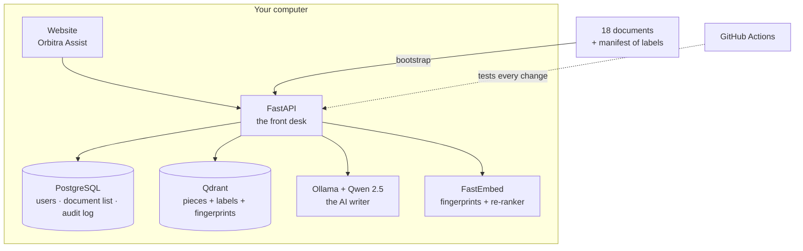

# 7. How it was built: the 12 phases

*The project was built in 12 steps, each one tested before the next began. Like building
a house: foundation, walls, wiring, locks, then inspection.*

---

## The building blocks (tools) in plain words

| Tool | What it is | Everyday comparison | Cost |
|---|---|---|---|
| **Python** | The programming language everything is written in | The language the instructions are written in | free |
| **FastAPI** | Builds the "API": the front desk that receives requests and sends replies | A reception desk | free |
| **PostgreSQL** | A database for users, the document list and the audit log | A filing cabinet | free |
| **Qdrant** | A search database that understands meaning and filters by labels | A librarian with a card catalogue | free |
| **FastEmbed** | Turns text into number fingerprints, on your own computer | A fingerprint machine | free |
| **Ollama** + **Qwen 2.5** | Runs an open-source AI model on your own computer | A writer who reads sources and drafts answers | free |
| **Docker** | Packages each piece into a ready-to-run box | Shipping containers | free |
| **GitHub Actions** | Runs the tests automatically on every change | A quality inspector on the production line | free (public projects) |
| **pytest** | Runs the 253 tests | A checklist that ticks itself | free |

---

## The 12 phases

### Phase 1: foundation
- **Goal:** an empty but working skeleton.
- **Built:** the project structure, the settings system, health checks ("are you alive?",
"can you reach your databases?") and Docker setup for the databases.
- **Comparison:** pouring the foundation and connecting water and electricity.

### Phase 2: a realistic fake company
- **Goal:** documents to test with, since real company documents would be private.
- **Built:** **Orbitra Systems**, with 18 generated documents (PDF, Word, Excel) across 4
levels, 9 people, the access label for every document, and 21 questions with known
answers. It also contains deliberate **traps**: a poisoned Wi-Fi guide, a salary column
inside a public spreadsheet, a person blocked from one report, and a secret layoff plan.
- **Comparison:** building a practice course before the real race.

### Phase 3: sign-in
- **Goal:** know reliably who is asking.
- **Built:** user accounts, scrambled passwords (bcrypt), signed tokens that expire, and the
rule that access level is always re-read from the database, never from the request.
- **Comparison:** photo ID badges that are checked at every door.

### Phase 4: reading documents
- **Goal:** turn files into clean, labelled pieces.
- **Built:** readers for PDF, Word and Excel, hidden-text removal, cutting into ~300-token
pieces with headers, and **column-level labels** for spreadsheets.
- **Problem solved:** the first PDF reader glued table cells together; the fix reads each
cell by its exact position on the page.

### Phase 5: fingerprints and storage
- **Goal:** make pieces searchable.
- **Built:** meaning fingerprints + keyword fingerprints, stored in Qdrant **with their labels**.
Re-running skips unchanged documents but notices label changes.

### Phase 6: secure search ⭐
- **Goal:** search that respects access.
- **Built:** the filter inside both search methods, the combination of results, the double
check (fail closed), and the careful re-ranker.
- **Measured:** 105 of 105 authorised searches found the right document; 0 unauthorised
searches did.

### Phase 7: the AI answer
- **Goal:** turn found pieces into a written answer, safely.
- **Built:** the AI connection (Ollama), the fixed rules, fenced sources, the input, context
and output guards, masking of sensitive numbers, and citations.
- **Problem solved:** the small 3B model misread the payroll table, so the project moved to
the 7B model, which runs on the laptop's graphics card.

### Phase 8: administration and hardening
- **Goal:** let an admin manage documents, and make the system harder to abuse.
- **Built:** upload, edit access, remove and re-index; the "no self-grant" rule; rate
limits; security headers on every response; upload checks.
- **Comparison:** adding a building manager, plus locks on every window.

### Phase 9: the audit log
- **Goal:** a trustworthy record of everything.
- **Built:** the tamper-evident chained log, masking in the log, `hidden` for things the viewer
can't read, security statistics, and a request ID on every response to trace problems.

### Phase 10: the website
- **Goal:** something people can actually use.
- **Built:** Orbitra Assist: sign-in, chat with clickable sources, suggested questions, the
demo person switcher, and the admin screens. It's built safely: no unsafe page code, and
a strict policy on what the page may load.

### Phase 11: the red-team exam
- **Goal:** prove the security claims.
- **Built:** the five exams (search, leaks, hijacking, poisoning, answers), the report, and
the 45 × 9 leak suite inside the everyday tests.
- **Found and fixed:** one real hijack, 16 detector misses, and 2 bugs in the exam itself.
- **Most important lesson:** the held-out test showed the detector catches only a third of
new attacks; the deeper layers are what protect.

### Phase 12: ready for the real world
- **Goal:** something others can install, trust and run.
- **Built:** automatic testing on GitHub (CI), weekly update checks (Dependabot), the
production setup (required secrets, protected databases, no demo mode), one-command setup
(`bootstrap`), the `smoke_test`, the `demo` script, `create_user` for real people, and all
of this documentation.
- **Found and fixed:** a vulnerable installer version, and the missing way to add real users
in production.

---

## How the pieces fit together

Everything inside the box runs **on your own computer**. Nothing is sent to an outside AI
company.

---

**Previous:** [← 6. Quality and testing](06-quality-and-testing.md) · **Next:** [8. FAQ and troubleshooting →](08-faq-troubleshooting.md)
